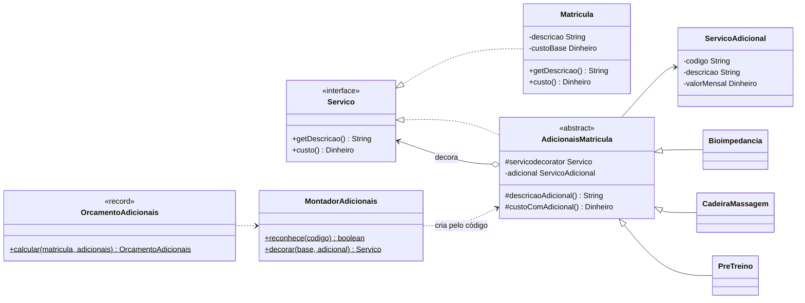
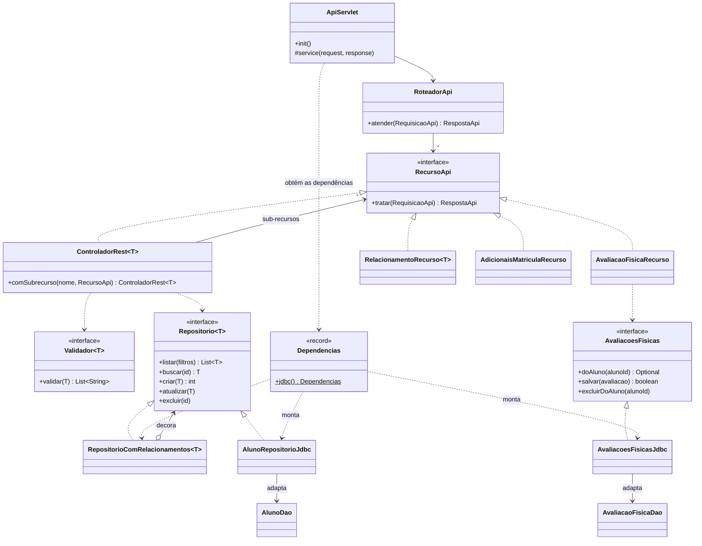
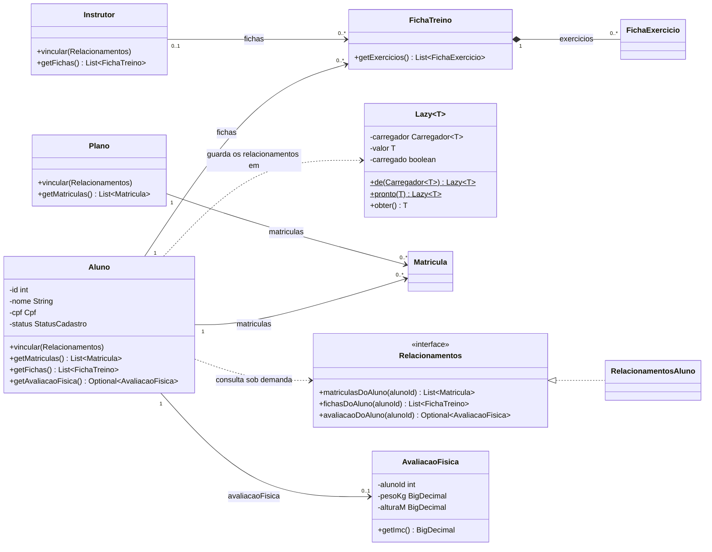
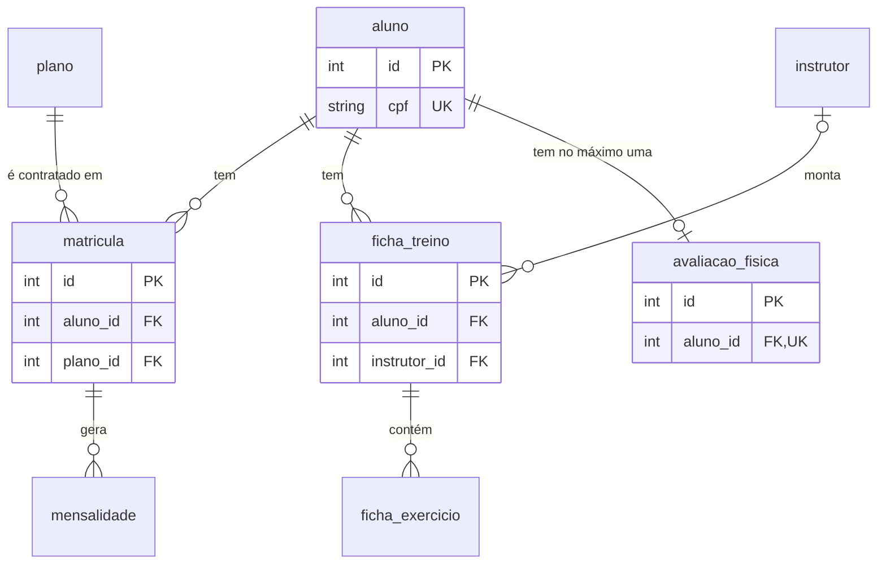
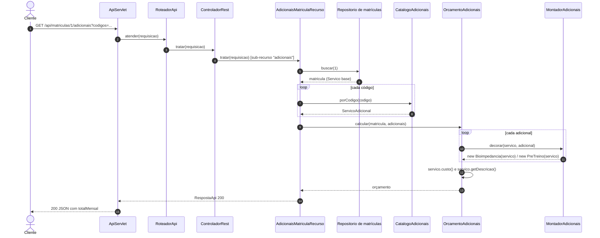
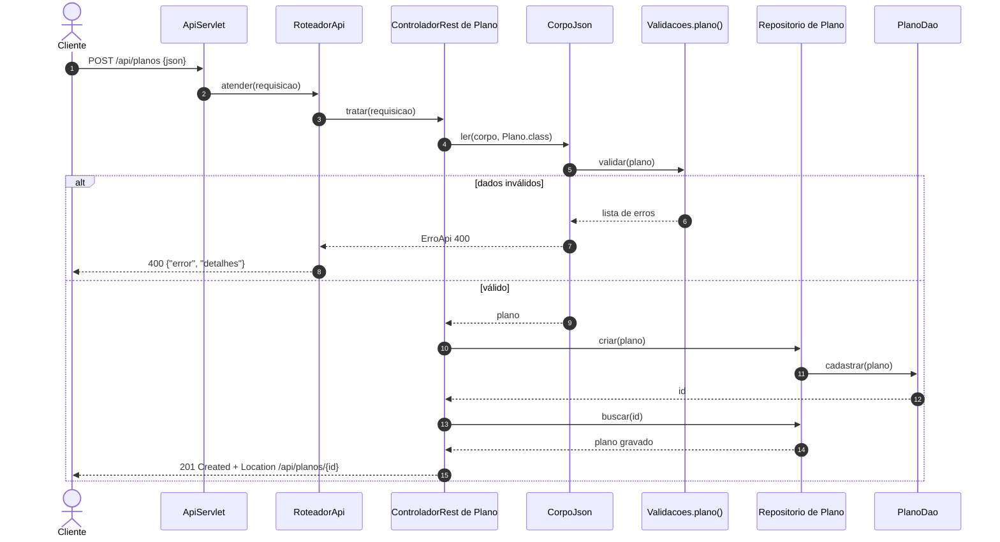
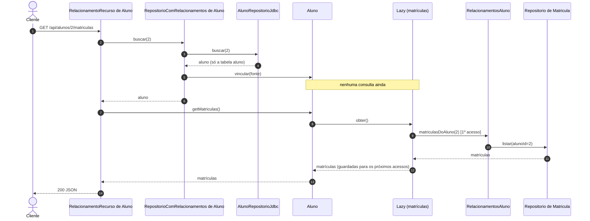
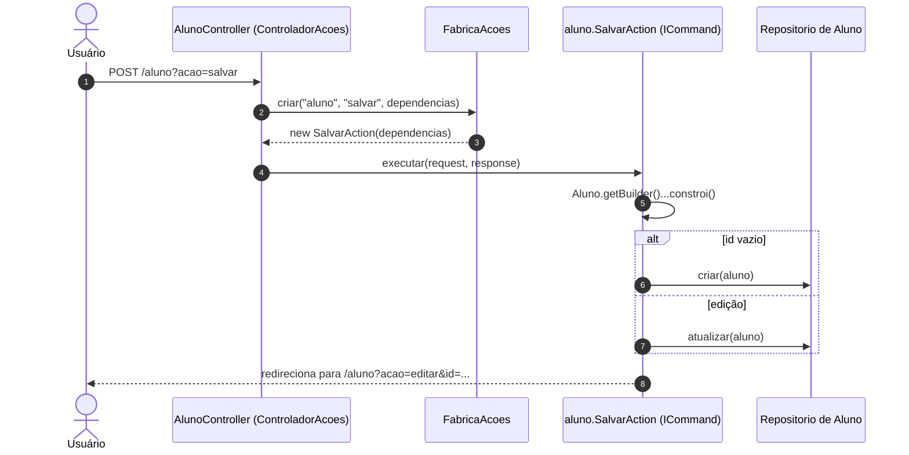

# Sistema de Academia

[](https://github.com/shinodaluk/academia-tarefa-faculdade-umc/actions/workflows/ci.yml)

Aplicação web para gestão de uma academia: cadastro de alunos, planos, instrutores,
matrículas, fichas de treino e avaliação física, com cálculo de serviços adicionais da matrícula.

Projeto acadêmico desenvolvido em Java (Servlet + JSP), sem framework de aplicação.

## Funcionalidades

- **Alunos** — cadastro, edição, exclusão, busca e filtro por status, indicadores de alunos ativos.
- **Planos** — cadastro com duração e valor mensal, ativação/desativação (plano com matrícula não pode ser excluído).
- **Instrutores** — cadastro com CREF, especialidade e status.
- **Matrículas** — vínculo aluno × plano, fidelidade, desconto estudante e dia de vencimento.
- **Fichas de treino** — ficha por aluno/instrutor com lista de exercícios (séries, repetições, carga).
- **Avaliação física** — uma por aluno (peso, altura, % de gordura, pressão, frequência cardíaca), com IMC calculado; editada na tela do aluno, pela API REST.
- **Adicionais da matrícula** — soma de serviços extras (Bioimpedância, Cadeira de massagem, Pré-treino) ao valor do plano.

## Tecnologias

| Camada | Tecnologia |
| --- | --- |
| Linguagem | Java 21 (LTS) |
| Web | Servlet / JSP (`javax.servlet`) |
| Servidor | Apache Tomcat 9 |
| Banco de dados | MySQL 8 (via Docker) |
| JSON | Gson 2.10.1 |
| Utilitários | Apache Commons Lang3 3.20.0, Commons Text 1.15.0 |
| Front-end | Vue 3 via CDN (sem build) |
| IDE / build | NetBeans + Ant |
| Testes | JUnit 5.11.4 (Jupiter) |
| Deploy | Docker (Tomcat 9 + MySQL 8) e GitHub Actions |

## Estrutura

```
src/java/
├── api/          API REST (/api/*): servlet, roteador, controlador genérico, validações
├── config/       Dependencias: único ponto que monta as implementações JDBC
├── repositorio/  Interfaces de persistência (Repositorio, CatalogoAdicionais, ...) e Filtros
│   │                 RepositorioComRelacionamentos e RelacionamentosAluno (lazy loading)
│   └── jdbc/         Adaptadores dos DAOs para essas interfaces
├── controller/   Servlets das telas, todos sobre a base ControladorAcoes
├── factory/      Ações das telas (Command) e a FabricaAcoes que as cria
├── dao/          Acesso ao banco com JDBC e PreparedStatement
├── model/        Entidades (com Builder), decorators, Lazy, objetos de valor (Dinheiro, Cpf) e enums
├── util/         Conexão com o banco, filtro de encoding, texto seguro e mensagens de erro
└── docs/
    ├── database/          Scripts SQL
    ├── docker-compose.yml MySQL para desenvolvimento
    ├── htmls/             Protótipos das telas
    └── jar/               Bibliotecas usadas pelo projeto
test/             Testes unitários (JUnit 5)
.github/workflows CI: testes + build da imagem + teste da API no container
Dockerfile        Compila o .war e publica no Tomcat 9
docker-compose.yml App + MySQL com os scripts SQL carregados na primeira subida
lib/              JUnit Console Standalone e Servlet API (só para compilar os testes)
web/              Páginas JSP, CSS e JS
```

## Entidades e relacionamentos

A proposta aprovada (Treino, Professor, Aluno, Plano, Matrícula) corresponde a estas classes:

| Proposta | Classe | Tabela | Atributos |
| --- | --- | --- | --- |
| Aluno | `model.Aluno` | `aluno` | 10 + 3 relacionamentos |
| Plano | `model.Plano` | `plano` | 8 + 1 relacionamento |
| Matrícula | `model.Matricula` | `matricula` | 15 |
| Professor | `model.Instrutor` | `instrutor` | 9 + 1 relacionamento |
| Treino | `model.FichaTreino` e `model.FichaExercicio` | `ficha_treino`, `ficha_exercicio` | 10 e 7 |
| (extra) Avaliação física | `model.AvaliacaoFisica` | `avaliacao_fisica` | 13 |

`Matricula` (15), `AvaliacaoFisica` (13), `Aluno` (10) e `FichaTreino` (10) têm pelo menos 10 atributos.

| Relacionamento | Tipo | No banco | Na entidade | Na API |
| --- | --- | --- | --- | --- |
| Aluno → Avaliação física | **1:1** | `avaliacao_fisica.aluno_id` `UNIQUE` | `aluno.getAvaliacaoFisica()` | `/api/alunos/{id}/avaliacao` |
| Aluno → Matrículas | 1:n | `matricula.aluno_id` | `aluno.getMatriculas()` | `/api/alunos/{id}/matriculas` |
| Aluno → Fichas | 1:n | `ficha_treino.aluno_id` | `aluno.getFichas()` | `/api/alunos/{id}/fichas` |
| Plano → Matrículas | 1:n | `matricula.plano_id` | `plano.getMatriculas()` | `/api/planos/{id}/matriculas` |
| Instrutor → Fichas | 1:n | `ficha_treino.instrutor_id` (opcional) | `instrutor.getFichas()` | `/api/instrutores/{id}/fichas` |
| Ficha → Exercícios | 1:n (composição) | `ficha_exercicio.ficha_id` | `ficha.getExercicios()` | `/api/fichas/{id}/exercicios` |
| Matrícula → Mensalidades | 1:n | `mensalidade.matricula_id` | (só no banco) | — |

### Lazy loading

Os relacionamentos ficam dentro da entidade, mas só são consultados quando o getter é chamado:

```java
Aluno aluno = alunos.buscar(2);        // SELECT só na tabela aluno
aluno.getMatriculas();                 // 1º acesso: consulta as matrículas do aluno
aluno.getMatriculas();                 // já carregado: nenhuma consulta
aluno.getAvaliacaoFisica();            // Optional: o 1:1 pode não existir
```

- `model.Lazy<T>` guarda o valor depois da primeira carga. Se o banco falhar, a falha não fica guardada
  e o próximo acesso tenta de novo.
- Cada entidade declara a interface `Relacionamentos` de que precisa (ex.: `Aluno.Relacionamentos`).
  O modelo não conhece o banco: quem implementa é `repositorio.RelacionamentosAluno`, sobre os repositórios.
- `repositorio.RepositorioComRelacionamentos` é um decorator de `Repositorio<T>`: toda entidade lida
  sai vinculada à sua fonte, sem nenhuma consulta extra até o getter ser usado.
- Os campos são `transient`: serializar a entidade em JSON não dispara as consultas. Os relacionamentos
  aparecem na API pelos sub-recursos acima.

## Padrões de projeto

### Decorator (implementado sem framework)

Usado para compor o valor mensal da matrícula com serviços adicionais.

| Papel | Classe |
| --- | --- |
| Componente | `model.Servico` (`getDescricao()`, `custo()`) |
| Componente concreto | `model.Matricula` |
| Decorator abstrato | `model.AdicionaisMatricula` |
| Decorators concretos | `model.Bioimpedancia`, `model.CadeiraMassagem`, `model.PreTreino` |

```java
Servico servico = matricula;
servico = new Bioimpedancia(servico, bioimpedancia);
servico = new PreTreino(servico, preTreino);

servico.custo();        // valor do plano + bioimpedância + pré-treino
servico.getDescricao(); // "Mensal, Bioimpedância, Pré-treino"
```

Cada decorator recebe o seu `ServicoAdicional` (código, descrição e valor) pelo construtor. Em produção
esses dados vêm da tabela `servico_adicional`; nos testes, são criados em memória. O decorator não acessa
o banco e rejeita um adicional de código diferente do seu.

O `model.MontadorAdicionais` liga cada código ao seu decorator por um mapa (`"PRE_TREINO" → PreTreino::new`),
e o `model.OrcamentoAdicionais` aplica a cadeia e monta o resultado usado pela tela e pela API.

### Outros padrões

- **Builder** — criação das entidades (`Plano.getBuilder().comNome(...).constroi()`).
- **Command** — cada ação das telas implementa `factory.ICommand`.
- **Factory** — `factory.FabricaAcoes` cria a ação a partir do recurso e do parâmetro `acao`
  (`plano` + `listar` → `factory.plano.ListarAction`). Aceita só letras e só classes que implementam `ICommand`.
- **DAO** — uma classe de acesso a dados por entidade, isolando o SQL.
- **Adapter** — `repositorio.jdbc.*Jdbc` adaptam cada DAO às interfaces de `repositorio`.
- **Front Controller** — `api.ApiServlet` recebe todo `/api/*` e o `api.RoteadorApi` escolhe o recurso.
- **Strategy** — cada recurso recebe seu `api.Validador<T>`; o `ControladorRest<T>` é o mesmo para todos.
- **Lazy Load** — `model.Lazy<T>` adia a consulta dos relacionamentos até o primeiro acesso.
- **Decorator (de novo)** — `repositorio.RepositorioComRelacionamentos` decora qualquer `Repositorio<T>`
  para vincular os relacionamentos das entidades lidas.

API e telas dependem só de interfaces (`Repositorio<T>`, `CatalogoAdicionais`, `IndicadoresAlunos`,
`Validador<T>`). As implementações JDBC são montadas em um único ponto, `config.Dependencias.jdbc()`
(composition root), e entregues pelo construtor: o `ApiServlet` passa para os controladores REST, e o
`ControladorAcoes` passa, via `FabricaAcoes`, para cada Action das telas. Nos testes, as mesmas classes
recebem versões em memória.

## Diagramas

Os diagramas estão em [Mermaid](https://mermaid.js.org/) e o GitHub os desenha direto nesta página.

### Diagrama de classes: Decorator dos adicionais



### Diagrama de classes: camadas da API e inversão de dependência

As setas tracejadas mostram o DIP: a API depende só das interfaces de `repositorio`; a única classe
que conhece as implementações JDBC é `Dependencias`.



Os outros recursos (`Plano`, `Instrutor`, `Matricula`, `FichaTreino`) seguem o mesmo desenho do aluno:
`*RepositorioJdbc` adaptando o `*Dao`.

### Diagrama de classes: entidades, relacionamentos e lazy loading

Cada entidade declara a interface `Relacionamentos` de que precisa, e o repositório entrega a
implementação. Os relacionamentos ficam em `Lazy<T>`: a consulta só acontece no primeiro acesso ao getter.



### Modelo de dados (relacionamentos no banco)



### Diagrama de sequência: valor da matrícula com adicionais (Decorator)

`GET /api/matriculas/1/adicionais?codigos=BIOIMPEDANCIA,PRE_TREINO`



### Diagrama de sequência: criar um plano

`POST /api/planos`



### Diagrama de sequência: matrículas do aluno (lazy loading)

`GET /api/alunos/2/matriculas`



### Diagrama de sequência: salvar pela tela (Command + Factory)

`POST /aluno?acao=salvar`



## Princípios aplicados

### SOLID

| Princípio | Onde |
| --- | --- |
| **S** — responsabilidade única | `ApiServlet` só traduz HTTP; `RoteadorApi` só escolhe o recurso e converte erros; `ControladorRest` só aplica o CRUD; `Validacoes` só valida; DAOs só acessam o banco |
| **O** — aberto/fechado | Adicional novo = subclasse de `AdicionaisMatricula` + uma entrada no mapa do `MontadorAdicionais`. Ação de tela nova = classe nova no pacote, sem mexer na `FabricaAcoes`. Recurso REST novo = uma linha em `ApiServlet.init()`. Valor novo de status/situação = uma constante no enum |
| **L** — substituição de Liskov | Qualquer `Servico` (a `Matricula` ou um decorator) pode ser decorado de novo; o `model.ServicoContratoTest` roda o mesmo contrato para todos. Qualquer `Repositorio<T>` (JDBC, decorado ou fake) serve ao `ControladorRest` |
| **I** — segregação de interfaces | `Servico` tem 2 métodos; `IndicadoresAlunos` tem 1; `AdicionaisMatriculaRecurso` depende de duas interfaces de 1 método (`FonteMatriculas`, `FonteAdicionais`) em vez do `Repositorio` inteiro; cada Action recebe só os repositórios que usa |
| **D** — inversão de dependência | Nenhuma Action, controlador REST ou decorator cria DAO ou acessa o banco: todos recebem interfaces pelo construtor, montadas só em `config.Dependencias`. As entidades definem a interface `Relacionamentos` e o repositório a implementa |

### Calistenia de Objetos

- **Encapsular primitivos** — `model.Dinheiro` (nunca negativo, centavos exatos com `BigDecimal`) e
  `model.Cpf` (11 dígitos, guardado com máscara) substituem `double` e `String`. Status, situação,
  objetivo e especialidade são enums (`StatusCadastro`, `SituacaoMatricula`, `ObjetivoTreino`,
  `Especialidade`): valor fora da lista é recusado na conversão, não chega ao banco.
- **Sem abreviações** — nomes completos (`plano`, `matricula`, `alunos` no lugar de `pla`, `mat`, `lAluno`).
- **Sem `else` nas classes novas** — validações e controladores usam retorno antecipado.
- **Classes pequenas** — cada classe da API tem uma responsabilidade e poucas dezenas de linhas.
- **Imutabilidade** — `Dinheiro`, `Cpf`, decorators, `RequisicaoApi`, `RespostaApi` e `OrcamentoAdicionais` são imutáveis.

Limitação conhecida: as entidades mantêm getters, porque o Gson e as JSPs dependem deles.

## Como executar

### Opção 1: Docker (um comando)

Precisa só do Docker:

```bash
docker compose up -d --build
```

- O compose compila o projeto, sobe o Tomcat e o MySQL e carrega os scripts SQL na primeira subida.
- A aplicação abre em `http://localhost:8080/WebApplication1`; para usar outra porta, `APP_PORT=8099 docker compose up -d`.
- `docker compose down` para; `docker compose down -v` também apaga o banco.

### Opção 2: NetBeans + Tomcat

Pré-requisitos: JDK 21 ou superior, Apache Tomcat 9, Docker e NetBeans.

1. Suba só o banco de dados:

   ```bash
   cd src/java/docs
   docker compose up -d
   ```

   O MySQL fica disponível em `localhost:3307` (usuário `root`, senha `sistema_root_dev`, só para desenvolvimento).

2. Crie o esquema, executando os scripts na ordem:

   ```bash
   docker exec -i academia-mysql mysql -uroot -psistema_root_dev < src/java/docs/database/01_esquema.sql
   docker exec -i academia-mysql mysql -uroot -psistema_root_dev < src/java/docs/database/03_procedimentos_e_dados.sql
   docker exec -i academia-mysql mysql -uroot -psistema_root_dev < src/java/docs/database/04_servicos_adicionais.sql
   docker exec -i academia-mysql mysql -uroot -psistema_root_dev < src/java/docs/database/05_avaliacao_fisica.sql
   ```

   `02_consultas_parametrizadas.sql` é referência das consultas usadas pelos DAOs e não precisa ser executado.
   Em um banco criado antes da avaliação física, basta rodar o `05_avaliacao_fisica.sql`.

3. Abra o projeto no NetBeans, configure o Tomcat 9 como servidor e execute (**Run**). As bibliotecas já
   apontam para `src/java/docs/jar/`. A aplicação abre em `http://localhost:8080/WebApplication1`.

A conexão usa estas variáveis de ambiente; sem elas, valem os padrões de desenvolvimento:

| Variável | Padrão |
| --- | --- |
| `ACADEMIA_DB_URL` | `jdbc:mysql://localhost:3307/academia` |
| `ACADEMIA_DB_USER` | `root` |
| `ACADEMIA_DB_PASSWORD` | `sistema_root_dev` |

## Testes

Testes unitários em `test/`, com JUnit 5. Não dependem de banco nem de servidor: as Actions das telas
recebem request/response falsos (`test/apoio/HttpFalso`, via `java.lang.reflect.Proxy`) e repositórios em
memória (`test/apoio/RepositorioFalso`), sem biblioteca de mock.

| Classe | O que cobre |
| --- | --- |
| `model.AdicionaisMatriculaTest` | Cada decorator soma seu valor e sua descrição, encadeamento de vários decorators, ordem da descrição, soma sem erro de ponto flutuante, base intacta e validação dos argumentos |
| `model.MatriculaTest` | `Matricula` como componente concreto do decorator e erro quando o plano não foi carregado |
| `model.MontadorAdicionaisTest` | Escolha do decorator pelo código do adicional |
| `model.OrcamentoAdicionaisTest` | Cadeia de decorators aplicada e resultado montado |
| `model.DinheiroTest` | Igualdade, soma exata, arredondamento, rejeição de negativo e formato JSON |
| `model.CpfTest` | Formato, máscara, dígitos verificadores e formato JSON |
| `model.DatasTest` | Datas ISO estritas (rejeita 30 de fevereiro e mês 13) |
| `model.AlunoJsonTest` | Contrato JSON do aluno com as telas e a API (`dataNascimento`, `cpf`) |
| `dao.MatriculaDaoTest` | Regra de preço: descontos de fidelidade e de estudante, arredondamento |
| `factory.FabricaAcoesTest` | Criação das ações e rejeição de nomes inválidos ou classes que não são `ICommand` |
| `factory.AcoesTelasTest` | Actions das telas com dependências em memória: listagem, filtros, salvar (novo/edição/conflito), excluir, indicadores, ficha com exercícios, adicionais |
| `model.RotulosTest` | Enums ↔ texto do banco/tela/JSON (com acento), rejeição de valor desconhecido |
| `controller.ControladorAcoesTest` | Ações que gravam exigem POST |
| `util.TextoSeguroTest` | Texto da URL não consegue fechar a tag `<script>` (proteção contra XSS) |
| `util.MensagensTest` | Mensagens para a tela sem SQL nem detalhes internos |
| `api.ControladorRestTest` | Verbos, status (200, 201, 204, 400, 404, 405, 409, 500), `Location`, `Allow`, id da URL x corpo, sub-recursos |
| `api.RequisicaoApiTest` | Interpretação do caminho `/recurso/{id}/sub` |
| `api.ValidacoesTest` | Regras de entrada de cada recurso (espelham as restrições do banco) |
| `api.AdicionaisMatriculaRecursoTest` | Cálculo dos adicionais via API usando o Decorator |
| `api.NormalizacaoFichaTest` | Valores padrão da ficha (data de hoje, ordem dos exercícios) |
| `model.ServicoContratoTest` | Contrato de `Servico` (Liskov) para a `Matricula`, cada decorator e os três empilhados |
| `model.AvaliacaoFisicaTest` | Cálculo do IMC e Builder da avaliação física |
| `model.LazyTest` | Carga só no primeiro acesso, valor reaproveitado, falha não guardada |
| `model.RelacionamentosEntidadesTest` | Relacionamentos de `Aluno`, `Plano` e `Instrutor` carregados sob demanda e fora do JSON |
| `repositorio.RepositorioComRelacionamentosTest` | Decorator vincula as entidades lidas; `RelacionamentosAluno` filtra pelo aluno |
| `repositorio.FiltrosTest` | Filtros numéricos (`alunoId`, `planoId`, ...) |
| `api.AvaliacaoFisicaRecursoTest` | 1:1 na API: GET, PUT criando (201) ou substituindo (200), DELETE, 404 e 405 |
| `api.RelacionamentoRecursoTest` | Sub-recursos 1:n (`/alunos/{id}/matriculas`): lista, lista vazia, 404 e 405 |

São 201 testes, que rodam em poucos segundos. Para rodar pelo terminal (PowerShell ou `pwsh`, precisa só do JDK 21):

```powershell
.\testes.ps1
```

O script compila o projeto e os testes em `build/testes` e roda a suíte com o JUnit Console. O GitHub Actions
roda o mesmo script a cada push e, se passar, sobe o `docker compose` e testa a API no container.
No NetBeans, os testes ficam em **Test Packages** e o JUnit já está no classpath de testes do projeto.

## API REST

Base: `http://localhost:8080/WebApplication1/api`. Corpo e respostas em JSON (UTF-8). As telas JSP
continuam funcionando em paralelo (seção [Telas](#telas)).

### Recursos

| Recurso | Coleção | Item | Filtros (query string) |
| --- | --- | --- | --- |
| Alunos | `/api/alunos` | `/api/alunos/{id}` | `busca`, `status` |
| Planos | `/api/planos` | `/api/planos/{id}` | `apenasAtivos=true` |
| Instrutores | `/api/instrutores` | `/api/instrutores/{id}` | `especialidade`, `status` |
| Matrículas | `/api/matriculas` | `/api/matriculas/{id}` | `situacao`, `alunoId`, `planoId` |
| Fichas de treino | `/api/fichas` | `/api/fichas/{id}` | `objetivo`, `alunoId`, `instrutorId` |

| Método | Caminho | Ação | Sucesso |
| --- | --- | --- | --- |
| `GET` | `/api/{recurso}` | Lista | `200 OK` |
| `POST` | `/api/{recurso}` | Cria | `201 Created` + cabeçalho `Location` + item criado |
| `GET` | `/api/{recurso}/{id}` | Busca um | `200 OK` |
| `PUT` | `/api/{recurso}/{id}` | Substitui | `200 OK` + item atualizado |
| `DELETE` | `/api/{recurso}/{id}` | Exclui | `204 No Content` |

O `id` vem sempre da URL; um `id` enviado no corpo é ignorado.

### Erros

Todo erro responde `{ "error": "mensagem" }`. Erros de validação trazem também `detalhes`.

| Status | Quando |
| --- | --- |
| `400 Bad Request` | JSON malformado, tipo de campo errado, corpo fora de UTF-8, id ou filtro não numérico, data inexistente, CPF inválido, valor negativo ou outra validação |
| `404 Not Found` | Recurso ou id inexistente |
| `405 Method Not Allowed` | Verbo não suportado no caminho (cabeçalho `Allow` lista os aceitos) |
| `409 Conflict` | Violação de integridade: CPF/CREF/nome duplicado, aluno/plano inexistente, plano com matrículas |
| `500 Internal Server Error` | Falha inesperada (detalhes só no log do servidor) |

### Exemplos

Criar um plano:

```http
POST /api/planos
Content-Type: application/json

{ "nome": "Trimestral Plus", "duracaoMeses": 3, "valorMensal": 119.90, "descricao": "Musculação + aulas", "ativo": true }
```

```http
HTTP/1.1 201 Created
Location: /WebApplication1/api/planos/5

{ "id": 5, "nome": "Trimestral Plus", "duracaoMeses": 3, "valorMensal": 119.90, "descricao": "Musculação + aulas", "ativo": true, "matriculasVinculadas": 0 }
```

Validação:

```http
HTTP/1.1 400 Bad Request

{ "error": "Dados inválidos.", "detalhes": ["nome é obrigatório", "duracaoMeses deve estar entre 1 e 36", "valorMensal é obrigatório"] }
```

### Campos

| Recurso | Campos de entrada |
| --- | --- |
| Aluno | `nome`*, `cpf`* (com ou sem máscara, dígitos verificadores conferidos), `dataNascimento`* (`yyyy-MM-dd`), `telefone`, `email`, `status`* (`Ativo`/`Inativo`) |
| Plano | `nome`*, `duracaoMeses`* (1–36), `valorMensal`* (≥ 0), `descricao`, `ativo` |
| Instrutor | `nome`*, `cref`*, `especialidade`* (`Musculação`/`Funcional`/`Condicionamento`/`Pilates`), `telefone`, `email`, `status`* |
| Matrícula | `alunoId`*, `planoId`*, `dataInicio`*, `fidelidadeMeses`* (0/6/12), `descontoEstudante`, `diaVencimento`* (1–28), `situacao`* (`Ativa`/`Cancelada`/`Suspensa`) |
| Avaliação física | `dataAvaliacao`*, `pesoKg`* (1–400), `alturaM`* (0,5–2,6), `percentualGordura` (0–70), `massaMagraKg`, `cinturaCm`, `pressaoArterial` (`120/80`), `frequenciaCardiaca` (20–250), `observacoes` |
| Ficha | `alunoId`*, `instrutorId`, `objetivo`* (`Hipertrofia`/`Emagrecimento`/`Condicionamento`), `dataCriacao` (padrão: hoje), `observacoes` (gravado no POST; o PUT mantém o valor atual, como a tela), `exercicios` (`nome`*, `series`*, `repeticoes`*, `cargaKg`) |

\* obrigatório. Na ficha, a `ordem` dos exercícios segue a posição na lista. Valores monetários
não podem ser negativos e datas inexistentes (ex.: `2024-02-30`) são rejeitadas.

### Relacionamentos

| Método | Caminho | Resposta |
| --- | --- | --- |
| `GET` | `/api/alunos/{id}/matriculas` | Matrículas do aluno |
| `GET` | `/api/alunos/{id}/fichas` | Fichas do aluno |
| `GET` | `/api/planos/{id}/matriculas` | Matrículas do plano |
| `GET` | `/api/instrutores/{id}/fichas` | Fichas montadas pelo instrutor |
| `GET` | `/api/fichas/{id}/exercicios` | Exercícios da ficha |
| `GET` | `/api/alunos/{id}/avaliacao` | Avaliação física do aluno (`404` se ainda não tiver) |
| `PUT` | `/api/alunos/{id}/avaliacao` | Cria (`201` + `Location`) ou substitui (`200`) a avaliação |
| `DELETE` | `/api/alunos/{id}/avaliacao` | Remove a avaliação (`204`) |

Os sub-recursos 1:n são só leitura (`405` nos outros verbos) e respondem `404` quando o dono não existe.
A avaliação física é um recurso único do aluno (1:1): não tem coleção nem `POST`, o aluno vem da URL e
o `imc` é calculado pelo servidor.

```http
PUT /api/alunos/4/avaliacao
Content-Type: application/json

{ "dataAvaliacao": "2026-11-20", "pesoKg": 80.5, "alturaM": 1.80 }
```

```http
HTTP/1.1 201 Created
Location: /WebApplication1/api/alunos/4/avaliacao

{ "id": 4, "alunoId": 4, "dataAvaliacao": "2026-11-20", "pesoKg": 80.50, "alturaM": 1.80, "imc": 24.8 }
```

### Adicionais da matrícula (Decorator)

`GET /api/matriculas/{id}/adicionais?codigos=BIOIMPEDANCIA,PRE_TREINO`

Calcula o valor mensal da matrícula com os adicionais aplicados como decorators. Códigos aceitos:
`BIOIMPEDANCIA`, `CADEIRA_MASSAGEM`, `PRE_TREINO`. Sem `codigos`, retorna só o valor base.

```json
{
  "matriculaId": 1,
  "descricaoBase": "Mensal",
  "custoBase": 129.90,
  "adicionais": [
    { "codigo": "BIOIMPEDANCIA", "descricao": "Bioimpedância", "valorMensal": 20.00 },
    { "codigo": "PRE_TREINO", "descricao": "Pré-treino", "valorMensal": 12.30 }
  ],
  "descricao": "Mensal, Bioimpedância, Pré-treino",
  "totalMensal": 162.20
}
```

Código desconhecido retorna `400`; matrícula ou adicional inexistente no banco, `404`.

## Telas

As telas usam um servlet por recurso, com a ação no parâmetro `acao`. `salvar` e `excluir` só aceitam
POST (GET responde `405`); ação inexistente responde `404`; id inválido na URL, `400`.

| Recurso | URL | Ações |
| --- | --- | --- |
| Alunos | `/aluno` | `listar`, `criar`, `editar`, `salvar`, `excluir` |
| Planos | `/plano` | `listar`, `criar`, `editar`, `salvar`, `excluir` |
| Instrutores | `/instrutor` | `listar`, `criar`, `editar`, `salvar`, `excluir` |
| Matrículas | `/matricula` | `listar`, `criar`, `editar`, `salvar`, `excluir`, `adicionais`, `calcularAdicionais` |
| Fichas | `/ficha` | `listar`, `criar`, `editar`, `salvar`, `excluir` |

A tela de adicionais usa `POST /matricula?acao=calcularAdicionais` com `{ "id": 1, "adicionais": [...] }`
e recebe o mesmo JSON do endpoint REST acima.
